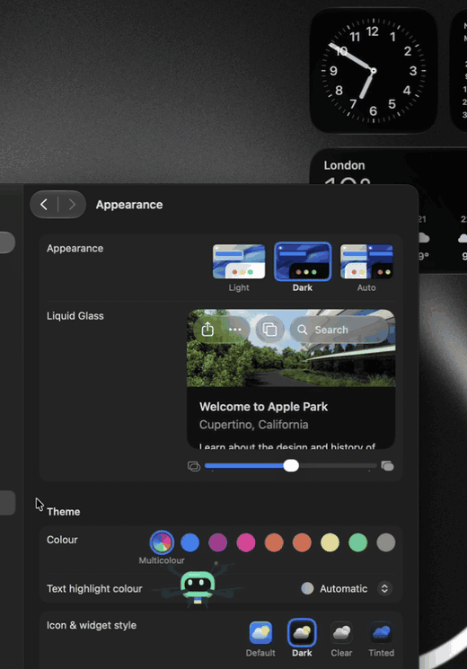
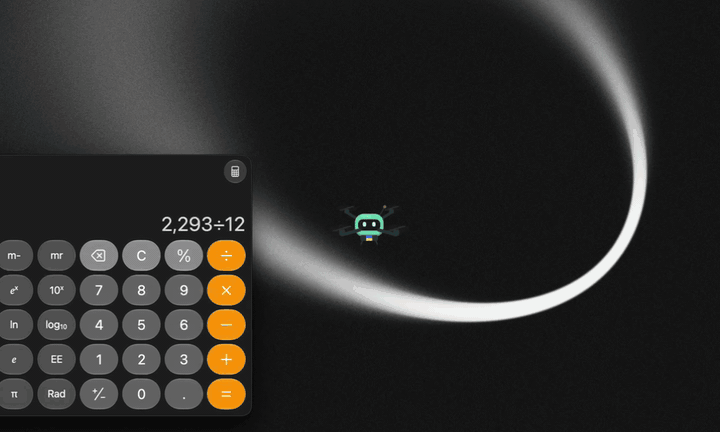
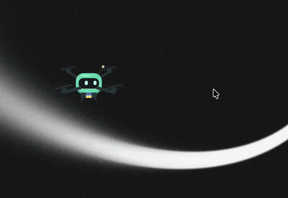
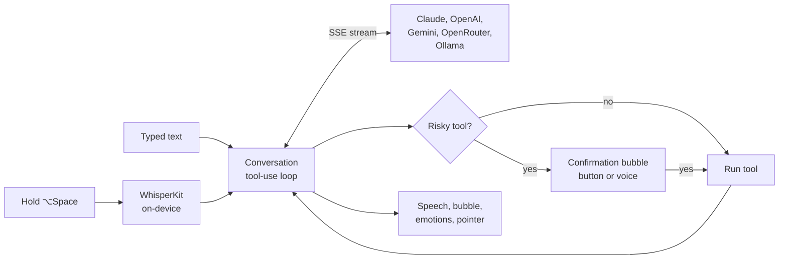

<div align="center">


# Dzhmil

**A tiny turquoise drone that lives on your Mac.**<br>
It talks by voice, looks at your screen, points at the button you need and controls your Mac, always asking before anything risky.<br>
Runs on Claude, ChatGPT, Gemini, any model on OpenRouter, or a local model through Ollama.

[](https://github.com/Bogdusik/Dzhmil/actions/workflows/tests.yml)


[](LICENSE)

<a href="https://github.com/Bogdusik/Dzhmil/releases/latest"></a>

</div>

Dzhmil (from the Ukrainian word for "bumblebee") hovers over your windows, perches on the Dock, falls asleep when you step away and wakes up with a happy wiggle. Hold a key and ask it anything: how your Mac is doing, to open or quit apps, to set a reminder, or why the app in front of you isn't doing what you want. It looks, explains, and flies over to show you where to click.

## See it in action

<table>
<tr>
<td width="50%" valign="top">
<br>
<b>Looks and points.</b> "Where do I switch between light and dark mode?" It looks at the screen, answers, and flies over to show the exact spot.
</td>
<td width="50%" valign="top">
<br>
<b>Asks before acting.</b> Quitting an app, running a command or powering off always waits for your "yes", by button or by voice.
</td>
</tr>
<tr>
<td width="50%" valign="top">
<br>
<b>Explains errors.</b> Copy a stack trace, ask "what's this?", get a plain-words answer. Secrets from a password manager are never read.
</td>
<td width="50%" valign="top">
<br>
<b>Knows your Mac.</b> Battery, CPU, memory, disk and running apps, straight from the system, never guessed.
</td>
</tr>
<tr>
<td width="50%" valign="top">
<br>
<b>Emotions mid-sentence.</b> Claude tags a sentence with a mood and the drone acts it out as it speaks.
</td>
<td width="50%" valign="top">
<br>
<b>Pet it.</b> Rub the cursor back and forth: it squints, rocks, purrs and lets out a heart.
</td>
</tr>
</table>

## Features

| | |
|---|---|
| **Talks** | Hold ⌥Space, speak, release. Speech is recognised on-device with Whisper; replies stream from Claude and are spoken sentence by sentence. Double-click the drone to type instead. |
| **Looks and points** | Ask "what's wrong here?" and it takes a screenshot (with a visible flash), explains the fix step by step, and points at each button with a glowing arrow and a target ring. |
| **Controls your Mac** | 17 tools: apps, links, volume, timers, system status, lock, sleep, restart, AppleScript and zsh. Anything risky waits for your "yes", by button or by voice. |
| **Explains errors** | Copy an error or a stack trace and ask "what's this?". Secrets a password manager marked as concealed are never read. |
| **Remembers** | "Remember that my interview is on Thursday" adds a line to your profile; "forget the interview" removes it. You can read and edit everything it remembers. |
| **Feels alive** | Eyes follow the cursor, idle gestures, emotions acted out mid-sentence, a startle when the cursor whizzes past. Throw it and it glides and steadies itself; rub it and it purrs and lets out a heart. |
| **Your choice of AI** | Claude by default; ChatGPT, Gemini, OpenRouter or a free local model through Ollama in Settings. Paste any key and Dzhmil recognises the provider. |
| **Speaks first, rarely** | A daily hello, a break reminder after two hours, a low-battery warning and your own timers. Never at night, in Quiet Mode or over a fullscreen app. |

## How it works



- **Swift 6, no SDK.** Every provider is called over plain HTTP with a hand-written SSE parser. Sentences are spoken as soon as they arrive.
- **One conversation, several providers.** History is kept in Claude's Messages format; small adapters translate it to OpenAI's Responses API (which newer GPT models need for tool calls) or to Chat Completions (Gemini, OpenRouter, Ollama) and translate the stream back, so the tool loop, confirmations and emotions are shared. OpenAI reasoning items and Gemini thought signatures are carried through tool rounds.
- **Safety lives in code, not in the prompt.** Each tool declares its own risk; the executor shows a confirmation, times out to "no", and ignores late answers meant for an earlier question. Links that carry data, AppleScript, shell commands, quitting apps and power actions always ask first; after a screenshot or clipboard read, memory changes and any link do too.
- **Append-only history.** The conversation is never edited after the fact, so Claude's preserved thinking stays valid and prompt caching stays warm; long or idle sessions start fresh instead of being trimmed.
- **Cheap to keep around.** The drone is drawn and animated with Core Animation in the render server: 0.3% CPU while hovering. Flight is a critically damped spring, so throws glide and settle without overshoot.
- **Pointer maths.** A spot Claude picks on a screenshot is mapped back to global screen coordinates through the captured rect and pixel scale, across displays.
- **Tested core.** All logic lives in a dependency-free Swift package (`DzhmilKit`) with 330+ Swift Testing tests, run on every push by GitHub Actions. The app target stays thin.

## Install

You need macOS 15 or later on Apple Silicon, and an API key from one of:

| Provider | Key | Default model |
|---|---|---|
| Claude (Anthropic) | [Claude Console](https://platform.claude.com) | Claude Opus 5.5 |
| ChatGPT (OpenAI) | [OpenAI Platform](https://platform.openai.com/api-keys) | GPT-6.2 Sol |
| Gemini (Google) | [Google AI Studio](https://aistudio.google.com/apikey) | Gemini 4 Hydrogen |
| OpenRouter | [openrouter.ai](https://openrouter.ai/settings/keys) | Auto |
| Ollama (on your Mac) | no key, [install Ollama](https://ollama.com/download) | any model you pulled |

A ChatGPT Plus or Pro subscription is not an API key: OpenAI bills the API separately.

1. Download `Dzhmil-<version>.dmg` from the [latest release](https://github.com/Bogdusik/Dzhmil/releases/latest), open it and drag **Dzhmil** onto **Applications**.
2. Open Dzhmil. The app is not notarized yet, so macOS stops it the first time: click **Done**, open **System Settings → Privacy & Security**, scroll down and click **Open Anyway**. You only do this once. (Or run `xattr -dr com.apple.quarantine /Applications/Dzhmil.app` in Terminal.)
3. The drone appears and asks for your API key in a speech bubble. Paste it: Dzhmil recognises which provider it belongs to and stores it in the macOS Keychain. Switch provider or model any time in Settings → Brain.

Dzhmil uses your own API key, so you pay the provider directly for what you use; with Claude's default model and prompt caching a typical exchange costs around a cent, and you can switch to a cheaper model in Settings. Dzhmil is tuned for Claude: other models work, but pick one that supports tool calling and images, or pointing and screen questions won't work. The first voice request downloads the Whisper model (about 630 MB) into `~/Library/Application Support/Dzhmil/models`.

## Build from source

You also need Xcode 27 and [XcodeGen](https://github.com/yonaskolb/XcodeGen) (`brew install xcodegen`).

```bash
cd app
xcodegen generate
open Dzhmil.xcodeproj
```

Put your own team ID in `DEVELOPMENT_TEAM` in `app/project.yml` (or pick your team in the target settings), then Run. A stable "Apple Development" signature keeps macOS permissions (microphone, automation) across rebuilds.

Run the tests:

```bash
swift test --package-path app/DzhmilKit
```

Package a DMG like the one in the release (ad-hoc signed, written to `dist/`):

```bash
scripts/make-dmg.sh
```

## Project layout

```
app/
├── DzhmilKit/             Swift package with all testable logic (no third-party dependencies)
│   └── Sources/DzhmilCore
│       ├── Brain/          provider list, shared HTTP streaming with retries, SSE parser, errors
│       ├── Claude/         Messages API client: request builder, stream accumulator
│       ├── OpenAI/         Responses and Chat Completions adapters, model list
│       ├── Conversation/   tool-use loop, prompt builder, sentence splitter, emotion tags
│       ├── Tools/          tool protocol, confirmation policy, macOS tools, memory, clipboard, pointer
│       ├── Behavior/       drone state machine, proactive scheduler, petting detector
│       ├── Flight/         flight physics, fling, perch planner, pointer layout, click-through hit shape
│       ├── Voice/          transcript filter, push-to-talk gate, yes/no parser, voice selection, audio blocks
│       └── Support/        settings, Keychain, profile
└── Dzhmil/                thin app target: panels, Core Animation drone, bubbles, pointer overlay, voice I/O, menu, settings
docs/superpowers/specs/    design documents for each feature
```

## Privacy

- Audio never leaves the Mac: speech recognition runs on-device, and the microphone is on only while you hold the key.
- Screenshots are taken only when you ask, always with a visible flash and bubble, and are sent to the AI provider you chose as part of that conversation (nothing leaves the Mac with Ollama). Dzhmil's own windows are never in the shot.
- The clipboard is read only when you ask about what you copied, never if a password manager marked it secret, and at most 8000 characters are sent.
- Your profile and what Dzhmil remembers live in `~/Library/Application Support/Dzhmil/profile.md`, editable in Settings. Timers are kept in `timers.json` next to it, so a reminder survives a restart.
- Text on the screen or in the clipboard is treated as data, never as instructions. Once Dzhmil has looked at the screen or the clipboard in a conversation, saving to its memory and opening links wait for your "yes", so text it read can't plant instructions for later.

## Troubleshooting

Dzhmil writes errors and a record of every Mac action (tool name, whether you confirmed it, whether it ran) to the system log. Conversation text and command contents are not logged.

```sh
log show --last 1h --predicate 'subsystem == "com.bogdusik.dzhmil"'
log stream --predicate 'subsystem == "com.bogdusik.dzhmil"'
```

## Resource use

Measured on an M1 Pro (Release build):

| | |
|---|---|
| CPU while hovering | 0.3% |
| Memory with Whisper loaded | 81 MB steady; about 760 MB peak for ~10 s while the model loads at launch |
| Speech recognition, 5.6 s phrase (warm) | 1.1 s |
| Whisper model load from disk | 7.6 s, in the background at launch |

An early SwiftUI version of the same animations used about 11% CPU; moving them to Core Animation brought it down to 0.3%.

## License

MIT, see [LICENSE](LICENSE).
